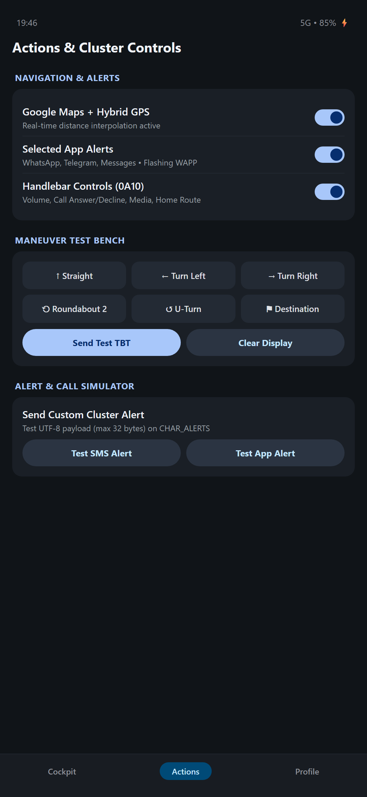

# RideNav Link

> **Compatibility and Independence Disclaimer:**  
> Independent application compatible with Bajaj Dominar and Pulsar motorcycles equipped with Bluetooth LCD dash. It is not an official product and is not affiliated with Bajaj Auto.

**RideNav Link** is a native Android application (pure Kotlin + Android SDK, zero external dependencies, no React Native, and no cloud telemetry) that acts as a Bluetooth Low Energy (BLE GATT) bridge between your smartphone and motorcycle digital LCD cluster.

[](https://hosted.weblate.org/engage/ride-nav-link/)

> 🇧🇷 **Documentação em Português disponível:** [README_PT.md](README_PT.md) | [RELATORIO_COMUNICACAO_PT.md](RELATORIO_COMUNICACAO_PT.md)

---

## 🌍 Community Translations (Weblate)

Help translate **RideNav Link** into your language!  
This project uses **Weblate** for community translations:

- **Weblate Project:** [https://hosted.weblate.org/projects/ride-nav-link/](https://hosted.weblate.org/projects/ride-nav-link/)
- Default language: **English** (`res/values/strings.xml`)
- Brazilian Portuguese: **Português (Brasil)** (`res/values-pt-rBR/strings.xml`)

---

## ☕ Support & Donations

**RideNav Link** is 100% free, offline, and open source. If you like this project and it helps you on your daily rides, consider supporting development:

- **Ko-fi:** [https://ko-fi.com/jonasoliveira](https://ko-fi.com/jonasoliveira)
- **PIX (Brasil):** `d5c50784-cdd3-4426-8778-d65e841c8dbb`

---

## 📱 Screenshots

| Cockpit (HUD & Telemetry) | Actions & Test Bench | Profile & Maintenance |
|---|---|---|
|  |  |  |

---

## Key Features

- **Turn-by-Turn Navigation via Google Maps + Hybrid GPS:**
  - Automatically captures active routes from **Google Maps** via `NotificationListenerService`.
  - Captures maneuvers, distances, ETD, ETA, and roundabout exits (`1st` to `7th`) and ensures **arrival at destination** display before ending navigation (`NAV OFF`).
  - Refines distance in real time using `LocationManager` (`GPS_PROVIDER` with fallback to `FUSED`/`NETWORK`), switching solid arrows to blinking arrows below `100 m` (and `< 40 m` upon arrival).
- **Native Calls and VoIP:**
  - Detects incoming, outgoing, active, call end (`CALL_END`), and missed calls via `TelephonyCallback` / `PhoneStateListener` and `CallStyle` notifications (WhatsApp, WhatsApp Business, dialer).
  - Resolves contact names via `ContactsContract` for cluster display.
- **Phone Status (`1 Hz`):**
  - Sends battery level (`0..4` bars), cellular signal strength (`0..4`), HFP intercom/headset status, current volume (`0..10`), and heartbeat.
- **SMS & App Alerts:**
  - Forwards incoming SMS and notifications from user-selected apps (WhatsApp, Telegram, Messages, etc.) with configurable mode (`Flashing WAPP`, `Flashing SMS`, or `Solid`).
- **Media and Audio:**
  - Integrates with `MediaSessionManager` to send track title, album, artist, playback time, duration, and play status (`PLAY` / `PAUSED` / `NONE`).
- **Bidirectional Handlebar Controls:**
  - Polls cluster control characteristic every `700 ms` to control: volume, accept/reject call, quick SMS decline, open home route in Google Maps, play/pause/next/previous (`x2`)/stop, and open preferred media player.
- **Background Stability & Privacy:**
  - `ForegroundService` (`connectedDevice|location`) with `PARTIAL_WAKE_LOCK`, auto BLE reconnection with backoff, GATT watchdog, MAC pinning, and `CompanionDeviceManager`.
  - **100% local/offline:** zero telemetry, analytics, trackers, or external servers.

---

## Project Structure

```text
.
├── ride_nav_link/
│   ├── app/src/main/
│   │   ├── AndroidManifest.xml
│   │   ├── java/com/custom/ridenavlink/
│   │   │   ├── AppPreferences.kt               # Local preferences and app filters
│   │   │   ├── BajajBleManager.kt              # BLE GATT manager, queue, telephony, watchdog
│   │   │   ├── BajajBridgeApp.kt               # Application singleton
│   │   │   ├── BajajForegroundService.kt       # Persistent foreground service + WakeLock
│   │   │   ├── BajajProtocol.kt                # BLE frame encoder/decoder
│   │   │   ├── BootCompletedReceiver.kt        # Auto-restart on device boot/update
│   │   │   ├── GoogleMapsNotificationParser.kt # PT-BR/EN Google Maps notification parser
│   │   │   ├── M3DesignSystem.kt               # Material 3 UI design system
│   │   │   ├── MainActivity.kt                 # Main UI, BLE scanner, test bench
│   │   │   ├── MapsHybridNavigator.kt          # GPS dead-reckoning between Maps anchors
│   │   │   └── MapsNotificationListener.kt     # Maps, VoIP, alerts, and MediaSession listener
│   │   └── res/                                # Adaptive icons, vectors, strings (i18n)
│   └── design_assets/                          # SVG brand kit & icons
├── build_clean.ps1                             # Direct build script (Windows / PowerShell)
├── build_clean.sh                              # Direct build script (Linux / macOS)
├── README.md                                   # Documentation (English - Default)
├── README_PT.md                                # Documentação (Português)
├── COMMUNICATION_PROTOCOL_REPORT.md            # Technical protocol specification (English - Default)
└── RELATORIO_COMUNICACAO_PT.md                 # Documentação técnica do protocolo (Português)
```

---

## Compilation and Installation

Builds directly with **Android SDK Build Tools + `kotlinc` + `d8` + `apksigner`**, without requiring Gradle.

### Windows (PowerShell)
```powershell
.\build_clean.ps1
```

### Linux / macOS
```bash
chmod +x build_clean.sh
./build_clean.sh
```

### ADB Install
```bash
adb install -r ride_nav_link/build/RideNavLink.apk
```

