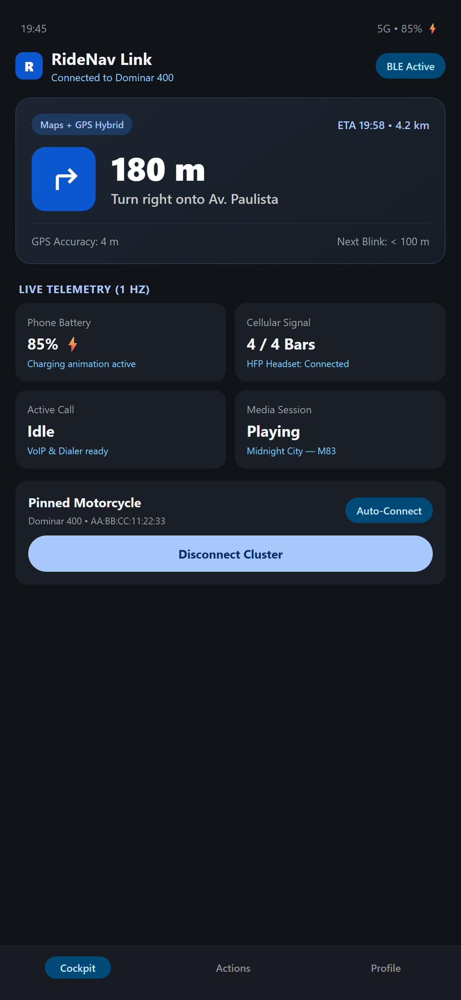
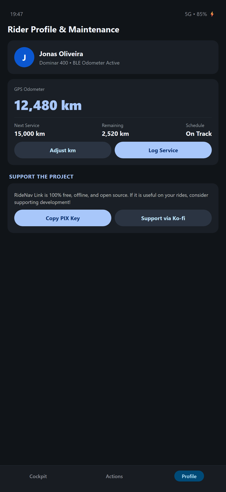

<div align="center">
  
  <h1>RideNav Link</h1>
  <p>
    <strong>Native, 100% offline BLE GATT bridge for motorcycle digital LCD clusters</strong><br />
    Turn-by-Turn Navigation (Google Maps + Hybrid GPS) · Calls &amp; VoIP · Telemetry · Alerts · Media &amp; Handlebar Controls
  </p>

  <p>
    <a href="https://github.com/jonas-oliveira-coder/ride-nav-link/releases/latest"></a>
    <a href="LICENSE"></a>
    <a href="https://github.com/jonas-oliveira-coder/ride-nav-link/releases/latest"></a>
    <a href="https://hosted.weblate.org/engage/ride-nav-link/"></a>
  </p>

  <p>
    <a href="https://ko-fi.com/jonasoliveira"></a>
  </p>

  <p>
    <a href="https://github.com/jonas-oliveira-coder/ride-nav-link/releases/latest"></a>
    &nbsp;
    <a href="https://apps.obtainium.imranr.dev/redirect?r=obtainium://add/https://github.com/jonas-oliveira-coder/ride-nav-link"></a>
  </p>

  <p>
    🇧🇷 <strong>Documentação em Português:</strong> <a href="README_PT.md">README_PT.md</a> · <a href="RELATORIO_COMUNICACAO_PT.md">Protocolo BLE (PT-BR)</a>
  </p>
</div>

> **Compatibility & Independence Disclaimer:**  
> Independent open-source application compatible with Bajaj Dominar and Pulsar motorcycles equipped with Bluetooth LCD clusters. Not an official product and not affiliated with Bajaj Auto.

---

## ⬇️ Download & Automatic Updates

- **Obtainium (Recommended — Automatic Updates):**
  1. Install [Obtainium](https://github.com/ImranR98/Obtainium/releases/latest) on your Android device.
  2. Tap the **Get it on Obtainium** badge above (or paste `https://github.com/jonas-oliveira-coder/ride-nav-link` into Obtainium).
  3. Obtainium tracks GitHub Releases directly and updates **RideNav Link** automatically whenever a new version is published.
- **GitHub Releases (Direct APK):**
  - Download `RideNavLink.apk` and its `RideNavLink.apk.sha256` checksum from [GitHub Releases](https://github.com/jonas-oliveira-coder/ride-nav-link/releases/latest).
- **F-Droid:** Inclusion request open at [F-Droid RFP #4852](https://gitlab.com/fdroid/rfp/-/issues/4852).

---

## 📱 Screenshots

<div align="center">

| Cockpit (HUD & Telemetry) | Actions & Test Bench | Profile & Maintenance |
|---|---|---|
|  |  |  |

</div>

---

## ✨ Key Features

- **Turn-by-Turn Navigation (Google Maps + Hybrid GPS):**
  - Automatically captures active **Google Maps** routes via `NotificationListenerService`.
  - Pure-Kotlin visual icon recognition (`IconShapeClassifier` + `GoogleMapsIconParser`) with dual-tone extraction, 32×32 template matching, 7-spoke roundabout angle detection (`1st`–`7th`), and composite destination detection.
  - Refines remaining meters in real time via `LocationManager` (`GPS_PROVIDER` with `FUSED`/`NETWORK` fallback), switches solid arrows to blinking below `100 m`, and holds the blinking arrival icon (`0 m`) for `25–35 s` when you reach your destination.
- **Native Calls & VoIP:**
  - Detects incoming, outgoing, active, call end (`CALL_END`), and missed calls via `TelephonyCallback` / `PhoneStateListener` and `CallStyle` notifications (Dialer, WhatsApp, WhatsApp Business).
  - Resolves contact names via `ContactsContract` and transliterates accented characters to US-ASCII for crisp LCD display.
- **Phone Telemetry (`1 Hz`):**
  - Sends battery level (`0..4` bars with charging animation), cellular signal (`0..4`), HFP headset status, volume (`0..10`), and heartbeat.
- **SMS & App Alerts:**
  - Forwards incoming SMS and notifications from user-selected apps with configurable cluster modes (`Flashing WAPP`, `Flashing SMS`, or `Solid`).
- **Media & Bidirectional Handlebar Controls:**
  - Sends track title, album, artist, playback position/duration, and status via `MediaSessionManager`.
  - Polls handlebar controls every `700 ms` for volume, answer/decline calls, quick SMS decline, Take Me Home navigation, play/pause/next/previous/stop, and media player launch.
- **Privacy & Stability First:**
  - Pure Kotlin + Android SDK — **zero third-party runtime dependencies**, **zero trackers**, **100% offline**.
  - Persistent `ForegroundService` (`connectedDevice|location`), auto BLE reconnection with backoff, GATT watchdog, MAC pinning, and `CompanionDeviceManager`.

---

## 🌍 Community Translations (Weblate)

Help translate **RideNav Link** into your language on [Hosted Weblate](https://hosted.weblate.org/projects/ride-nav-link/):
- Default: **English** (`res/values/strings.xml`)
- Brazilian Portuguese: **Português (Brasil)** (`res/values-pt-rBR/strings.xml`)

---

## ☕ Support & Donations

**RideNav Link** is 100% free, offline, and open source. If it helps you on your daily rides:
- **Ko-fi:** [https://ko-fi.com/jonasoliveira](https://ko-fi.com/jonasoliveira)
- **PIX (Brasil):** `d5c50784-cdd3-4426-8778-d65e841c8dbb`

---

## 🗂️ Project Structure

```text
.
├── ride_nav_link/app/src/
│   ├── main/
│   │   ├── AndroidManifest.xml
│   │   ├── java/com/custom/ridenavlink/
│   │   │   ├── AppPreferences.kt               # Local preferences and app filters
│   │   │   ├── BajajBleManager.kt              # BLE GATT manager, queue, telephony, watchdog
│   │   │   ├── BajajBridgeApp.kt               # Application singleton
│   │   │   ├── BajajForegroundService.kt       # Persistent foreground service + WakeLock
│   │   │   ├── BajajProtocol.kt                # BLE frame encoder/decoder & LCD transliteration
│   │   │   ├── BootCompletedReceiver.kt        # Auto-restart on boot/update
│   │   │   ├── GoogleMapsIconParser.kt         # Dual-tone bitmap & 7-spoke roundabout parser
│   │   │   ├── GoogleMapsNotificationParser.kt # PT-BR/EN Google Maps notification parser
│   │   │   ├── IconShapeClassifier.kt          # Pure-Kotlin 32x32 template & geometry classifier
│   │   │   ├── M3DesignSystem.kt               # Material 3 UI design system
│   │   │   ├── MainActivity.kt                 # Main UI, BLE scanner, test bench
│   │   │   ├── MaintenanceManager.kt           # Maintenance reminders
│   │   │   ├── MapsHybridNavigator.kt          # GPS dead-reckoning & arrival retention
│   │   │   └── MapsNotificationListener.kt     # Maps, VoIP, alerts, and MediaSession listener
│   │   └── res/                                # Adaptive icons, vectors, strings (i18n)
│   └── test/                                   # JVM unit tests (icon shapes, parser, ASCII)
├── docs/badges/                                # Official GitHub & Obtainium download badges
├── fastlane/metadata/android/                  # F-Droid / Fastlane metadata & screenshots
├── gradle/wrapper/                             # Gradle Wrapper (with SHA-256 verification)
├── COMMUNICATION_PROTOCOL_REPORT.md            # Technical BLE protocol specification (EN)
└── RELATORIO_COMUNICACAO_PT.md                 # Especificação técnica do protocolo BLE (PT-BR)
```

---

## 🛠️ Build & Test

Built with standard **Gradle** (JDK 21 + Android SDK `compileSdk 34`), zero third-party runtime dependencies, and reproducible build flags (`dependenciesInfo { includeInApk = false }`).

```bash
# Run unit tests
./gradlew testDebugUnitTest

# Build release APK
./gradlew assembleRelease

# Build & install debug APK via ADB
./gradlew assembleDebug
adb install -r ride_nav_link/app/build/outputs/apk/debug/app-debug.apk
```
