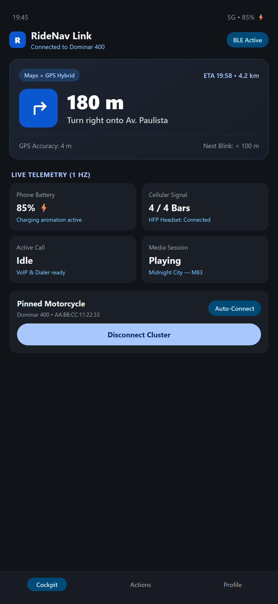
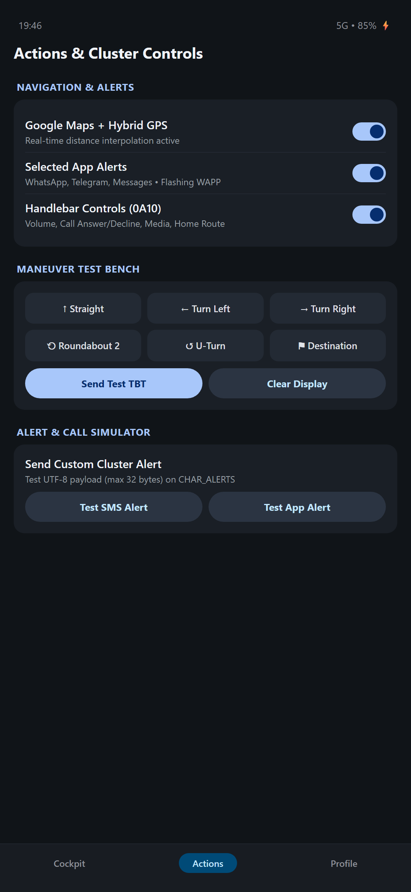
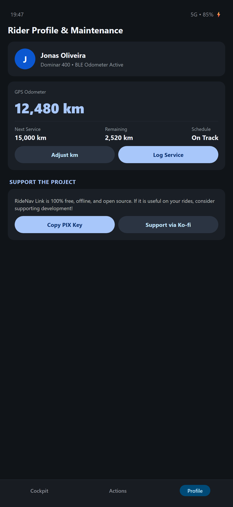

<div align="center">
  
  <h1>RideNav Link</h1>
  <p>
    <strong>Ponte BLE GATT nativa e 100% offline para painel digital LCD de motocicletas</strong><br />
    Navegação Turn-by-Turn (Google Maps + GPS Híbrido) · Ligações &amp; VoIP · Telemetria · Alertas · Mídia e Comandos do Guidão
  </p>

  <p>
    <a href="https://github.com/jonas-oliveira-coder/ride-nav-link/releases/latest"></a>
    <a href="LICENSE"></a>
    <a href="https://github.com/jonas-oliveira-coder/ride-nav-link/releases/latest"></a>
    <a href="https://hosted.weblate.org/engage/ride-nav-link/"></a>
  </p>

  <p>
    <a href="https://ko-fi.com/jonasoliveira"></a>
  </p>

  <p>
    <a href="https://github.com/jonas-oliveira-coder/ride-nav-link/releases/latest"></a>
    &nbsp;
    <a href="https://apps.obtainium.imranr.dev/redirect?r=obtainium://add/https://github.com/jonas-oliveira-coder/ride-nav-link"></a>
  </p>

  <p>
    🇬🇧 <strong>English documentation (default):</strong> <a href="README.md">README.md</a> · <a href="COMMUNICATION_PROTOCOL_REPORT.md">BLE Protocol (EN)</a>
  </p>
</div>

> **Aviso de Compatibilidade e Independência:**  
> Aplicativo independente e open-source compatível com motocicletas Bajaj Dominar e Pulsar equipadas com painel Bluetooth. Não é um produto oficial e não possui vínculo com a Bajaj Auto.

---

## ⬇️ Download e Atualizações Automáticas

- **Obtainium (Recomendado — Atualizações Automáticas):**
  1. Instale o [Obtainium](https://github.com/ImranR98/Obtainium/releases/latest) no seu Android.
  2. Toque no botão **Get it on Obtainium** acima (ou cole `https://github.com/jonas-oliveira-coder/ride-nav-link` no Obtainium).
  3. O Obtainium acompanha os **GitHub Releases** diretamente e atualiza o **RideNav Link** automaticamente sempre que sair uma nova versão.
- **GitHub Releases (APK Direto):**
  - Baixe `RideNavLink.apk` e o checksum `RideNavLink.apk.sha256` em [GitHub Releases](https://github.com/jonas-oliveira-coder/ride-nav-link/releases/latest).
- **F-Droid:** Solicitação de inclusão aberta em [F-Droid RFP #4852](https://gitlab.com/fdroid/rfp/-/issues/4852).

---

## 📱 Capturas de Tela (Screenshots)

<div align="center">

| Cockpit (HUD & Telemetria) | Ações & Bancada de Testes | Perfil & Manutenção |
|---|---|---|
|  |  |  |

</div>

---

## ✨ Principais Funcionalidades

- **Navegação Turn-by-Turn (Google Maps + GPS Híbrido):**
  - Captura automaticamente rotas ativas do **Google Maps** via `NotificationListenerService`.
  - Reconhecimento visual em Kotlin puro (`IconShapeClassifier` + `GoogleMapsIconParser`) com extração dual-tone, templates 32×32, leitura angular de rotatória de 7 pontas (`1ª`–`7ª`) e detecção de destino composto.
  - Refina a contagem de metros em tempo real via `LocationManager` (`GPS_PROVIDER` com fallback `FUSED`/`NETWORK`), pisca a seta abaixo de `100 m` e mantém o ícone de chegada piscando (`0 m`) por `25–35 s` ao chegar ou quando a notificação do Maps some.
- **Chamadas Nativas e VoIP:**
  - Detecta ligações recebidas, efetuadas, ativas, encerradas (`CALL_END`) e perdidas via `TelephonyCallback` / `PhoneStateListener` e notificações `CallStyle` (Discador, WhatsApp, WhatsApp Business).
  - Resolve nomes via `ContactsContract` e translitera acentos para ASCII puro (`á → a`, `ç → c`) para exibição limpa no LCD.
- **Telemetria do Telefone (`1 Hz`):**
  - Envia barras de bateria (`0..4` com animação de carregamento), sinal celular (`0..4`), status de headset HFP, volume (`0..10`) e heartbeat.
- **Alertas de SMS e Aplicativos:**
  - Encaminha SMS e notificações de aplicativos escolhidos pelo usuário com modo configurável (`Piscante WAPP`, `Piscante SMS` ou `Aceso Fixo`).
- **Mídia e Comandos Bidirecionais do Guidão:**
  - Envia título, álbum, artista, tempo decorrido/duração e estado de reprodução via `MediaSessionManager`.
  - Lê os botões do punho a cada `700 ms` para volume, atender/recusar chamadas, SMS rápido de recusa, rota para casa, play/pause/próxima/anterior/stop e abrir player de mídia.
- **Privacidade e Estabilidade:**
  - Kotlin + Android SDK puro — **zero dependências externas em runtime**, **zero rastreadores**, **100% offline**.
  - `ForegroundService` persistente (`connectedDevice|location`), reconexão BLE automática com backoff, watchdog GATT, fixação por MAC e `CompanionDeviceManager`.

---

## 🌍 Tradução Comunitária (Weblate)

Ajude a traduzir o **RideNav Link** no [Hosted Weblate](https://hosted.weblate.org/projects/ride-nav-link/):
- Padrão internacional: **Inglês** (`res/values/strings.xml`)
- Brasil: **Português (Brasil)** (`res/values-pt-rBR/strings.xml`)

---

## ☕ Apoio e Doações

O **RideNav Link** é 100% gratuito, offline e open-source. Se ele ajuda nas suas viagens e no dia a dia:
- **Ko-fi:** [https://ko-fi.com/jonasoliveira](https://ko-fi.com/jonasoliveira)
- **PIX:** `d5c50784-cdd3-4426-8778-d65e841c8dbb`

---

## 🗂️ Estrutura do Projeto

```text
.
├── ride_nav_link/app/src/
│   ├── main/
│   │   ├── AndroidManifest.xml
│   │   ├── java/com/custom/ridenavlink/
│   │   │   ├── AppPreferences.kt               # Preferências locais e filtros de apps
│   │   │   ├── BajajBleManager.kt              # Gerenciador BLE GATT, fila serial, telefonia e watchdog
│   │   │   ├── BajajBridgeApp.kt               # Application singleton
│   │   │   ├── BajajForegroundService.kt       # Serviço persistente em primeiro plano + WakeLock
│   │   │   ├── BajajProtocol.kt                # Codificação BLE e transliteração ASCII para o LCD
│   │   │   ├── BootCompletedReceiver.kt        # Reinício automático pós-boot/atualização
│   │   │   ├── GoogleMapsIconParser.kt         # Extração dual-tone de bitmap e rotatória de 7 pontas
│   │   │   ├── GoogleMapsNotificationParser.kt # Parser PT-BR/EN de notificações do Google Maps
│   │   │   ├── IconShapeClassifier.kt          # Classificador Kotlin puro (templates 32x32 + geometria)
│   │   │   ├── M3DesignSystem.kt               # Sistema visual Material 3 nativo
│   │   │   ├── MainActivity.kt                 # Interface principal, scanner BLE, testes e diagnóstico
│   │   │   ├── MaintenanceManager.kt           # Lembretes de manutenção
│   │   │   ├── MapsHybridNavigator.kt          # Interpolação GPS e retenção de chegada ao destino
│   │   │   └── MapsNotificationListener.kt     # Listener de Maps, VoIP, alertas e MediaSession
│   │   └── res/                                # Vetores adaptativos, ícones e strings (i18n)
│   └── test/                                   # Testes unitários JVM (ícones, parser, ASCII)
├── docs/badges/                                # Badges oficiais GitHub e Obtainium
├── fastlane/metadata/android/                  # Metadados F-Droid / Fastlane e capturas
├── gradle/wrapper/                             # Gradle Wrapper (com verificação SHA-256)
├── COMMUNICATION_PROTOCOL_REPORT.md            # Relatório técnico do protocolo BLE (EN)
└── RELATORIO_COMUNICACAO_PT.md                 # Relatório técnico do protocolo BLE (PT-BR)
```

---

## 🛠️ Como Compilar e Testar

Compilado com **Gradle padrão** (JDK 21 + Android SDK `compileSdk 34`), zero dependências externas em runtime e build reprodutível (`dependenciesInfo { includeInApk = false }`).

```bash
# Executar testes unitários
./gradlew testDebugUnitTest

# Compilar APK de release
./gradlew assembleRelease

# Compilar e instalar APK debug via ADB
./gradlew assembleDebug
adb install -r ride_nav_link/app/build/outputs/apk/debug/app-debug.apk
```
